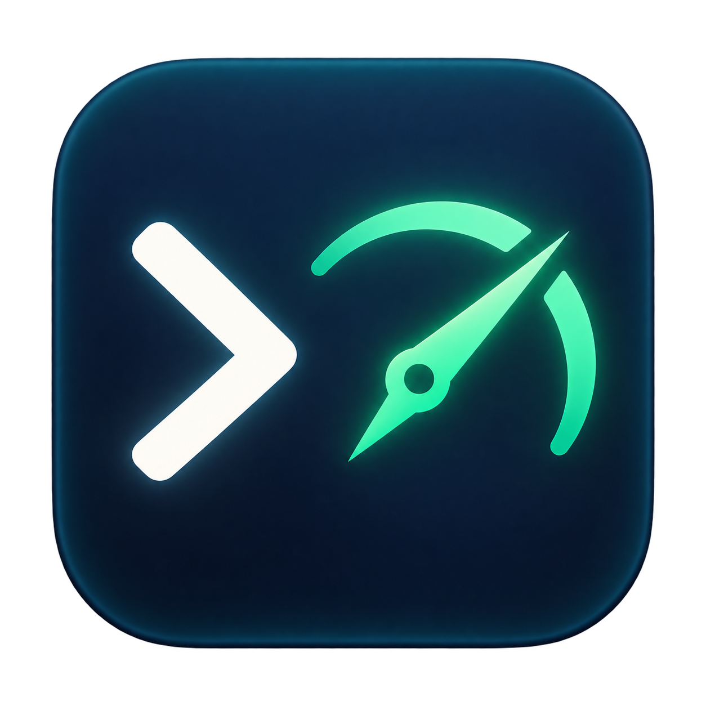

# Codex Speed Menu



A native macOS menu bar app for completed Codex response speed. Requires macOS 14 or later. The release is universal (Apple silicon and Intel), with a custom app icon and a compact text-only menu bar display.

## Install

Download `Codex-Speed-1.1.0.zip` from the [latest GitHub Release](https://github.com/qoli/CodexSpeedMenu/releases/latest), unzip it, and move **Codex Speed.app** to Applications. Open the app to show its menu bar item. Version 1.1.0 is Developer ID signed and notarized by Apple, with the notarization ticket stapled to the app.

The release includes `SHA256SUMS` for verifying the download:

```sh
shasum -a 256 -c SHA256SUMS
```

For a source build, open `dist/Codex Speed.app` after running `scripts/build.sh`.

## Usage

The Menu Bar shows only a number (for example `20.0`) for the most recently
completed valid model response's effective output token/s, or `idle` when unknown.
It includes reasoning tokens already included in output usage.
It does not represent pure decode speed. Click for completion time, thread/turn,
model, rollout filename, an optional **Keep Mac Awake for Codex** checkbox and Quit. Around 60 seconds later (checked every 10 seconds), the Menu Bar clears to
`idle`; the last completed sample remains explicitly dated in the menu.
The number is always a completed response measurement, not live streaming.
Menu information rows have a maximum text width of 420 points. Longer values are shortened
in the middle with `…`; hovering shows the complete value in the native tooltip.

The keep-awake checkbox is off by default and persists across launches. When enabled,
each newly completed speed sample acquires or renews a five-minute idle-system-sleep
lease. Enabling it while a fresh speed is visible starts the lease immediately. With
no newer sample the lease expires naturally; disabling it or quitting releases it
immediately. The display may still sleep, and explicit sleep, lid-close and shutdown
behavior are unchanged.

Only the current user's `~/.codex/sessions` and necessary `~/.codex/archived_sessions` JSONL files
are read. There is no network component, web integration, IPC, tokenizer, quota
tracking, model probe, traffic proxy, credentials access or login startup.
Existing applications, repositories and Codex configuration are untouched.

## Algorithm and boundaries

The reducer ports MIT `adenta/codex-tps` at `be549617f50409c8c0e15a8a6838520ec12d2bb1`.
For each old `event_msg/token_count`, it divides `info.last_token_usage.output_tokens`
by the time from the latest eligible input boundary to the last generated
`response_item` (reasoning, assistant message or *_call). While generated output
is pending, tool return items do not move that start. A processed old usage record
starts the next response window at its own timestamp. This preserves upstream
behavior even when old usage is written after tool drain; no per-user-turn average
is invented. New `token_usage_record` is used only to match thread, turn and response
identity; it never emits a sample or changes the timer. Its response ID is attached
only when usage/turn/timestamp match; otherwise the filename/thread/turn identify
the source. Duplicate cumulative usage notifications are ignored.

Each rollout has an independent reducer. The first explicit thread_id binds its
identity without resetting timing, since session_meta.id/session_id can name a
shared parent. Subsequent explicit thread changes invalidate its pending window. Parallel subagents are never summed into parent throughput.
When data is missing, malformed, oversized, aborted or has nonpositive duration,
the affected window is discarded. A witnessed task_started or old usage boundary
can establish the next complete window. Reading a partial history never produces
a sample from an unknown start.

## Resource bounds

Startup enumerates metadata once and starts every tracked file at its current EOF.
Only the current byte cursor, bounded incomplete-line bytes and response timing
exist in process memory. There is no identity/anchor validation or recovery system. Nothing is persisted. Restart starts cold at
current EOF again; it does not replay records written while the App was stopped.
If the EOF is inside a line, its remainder is discarded through the next newline.
Unknown response starts are never guessed. A witnessed task_started or old usage
boundary establishes a later complete window.

Truncation drops the current window and cursor to current EOF. The vnode source
discards a reader when the source is removed/replaced/renamed; if its path exists
again it is watched from the new EOF. No replacement history is replayed. In-place
rewrites that do not shrink the file are not detected. New discoveries
also start at their current EOF. Previously created offsets.json files are retained
as unused artifacts; the current runtime never opens or writes them.

FSEvents discovers new files; per-file vnode sources detect writes even while the
writer remains open. Up to 512 watch descriptors are used. If needed, the app
raises only its own process descriptor soft limit to 640 (within the existing hard
limit). All notifications run on one serial background queue and are coalesced into
changed paths; one timer drains them once a second. A fair rotating schedule reads
at most 256 KiB per file and 1 MiB total per tick, with one UI update for the newest
completed sample per tick. No per-record Tasks are created. Metadata safety scans
are every 5 minutes; dropped-notification recovery scans are limited to once per
30 seconds. A delayed notification can delay display. New files begin at discovery-time EOF, with subsequent appends read under the
same budgets.

At most 512 rollouts are tracked, selected by recency. Partial lines are capped at
64 KiB each (32 MiB aggregate worst case), plus a bounded read chunk and metadata.
Oversized lines are skipped through their next newline and invalidate the affected
window. `.jsonl.zst` archives are not decompressed. Symlink files are rejected;
`realpath` normalizes macOS directory aliases. Heavy backlog is drained gradually.

## Build and verify

```sh
scripts/build.sh    # local ad-hoc signed SwiftPM build
scripts/test.sh     # reducer, tailer and real FSEvents integration tests
scripts/release.sh  # universal Xcode archive, cloud Developer ID export and notarization
```

The release script uses the existing Xcode account for developer team
`WQY45CL427` and Keychain profile `SwiftChat-Notary`. Override these with
`DEVELOPMENT_TEAM` and `NOTARY_PROFILE` when building under another account.
Credentials and private keys are never copied into the project. The script enables
hardened runtime, obtains a timestamped Developer ID signature, submits the app to
Apple, staples the accepted ticket and verifies Gatekeeper before creating
`dist/Codex-Speed-<version>.zip`. Intermediate archives and submission IDs remain in
`dist/` and `Evidence/` for diagnosis. A failed export or notarization stops the release.

`CodexSpeedMenu.xcodeproj` is included. After editing `project.yml`, regenerate it
with `xcodegen generate`. `scripts/make-icon.sh` creates the ICNS sizes from
`Assets/AppIcon.png` using the macOS image tools.

The local SwiftPM build uses an individually created `/tmp` directory recorded in
`Evidence/build-location.txt`. Its signature is ad-hoc and it does not perform
notarization. Use `scripts/release.sh` for the distributable app.

Normal runtime writes no progress files or test data. The explicit native
`--ui-smoke` flag injects the embedded public upstream fixture, captures the actual
AppKit status button for waiting, speed and expiry, and invokes the Quit menu
item. Its `Evidence` directory is beside the app. This test covers native UI and
termination, the keep-awake checkbox and assertion acquisition/release; it does not
prove a fresh production response measurement.

## Diagnostics

Codex Speed records monitor, UI and idle-sleep lease decision points in macOS
Unified Logging under the `cc.ronniewong.CodexSpeedMenu` subsystem. Logs contain rollout filenames,
thread IDs, byte offsets, counters, timestamps and error descriptions. They never
contain prompts, response text, tool output, credentials or token contents.

For a live reproduction, start streaming before the failure:

```sh
/usr/bin/log stream --style compact --level debug \
  --predicate 'subsystem == "cc.ronniewong.CodexSpeedMenu"'
```

To inspect persisted information after a failure:

```sh
/usr/bin/log show --last 15m --style compact --info \
  --predicate 'subsystem == "cc.ronniewong.CodexSpeedMenu"'
```

The trace distinguishes source discovery, vnode/FSEvents delivery, reads,
oversized-line or truncation resets, sample selection, and the final UI state.

See [the 1.0.4 validation summary](docs/VALIDATION-1.0.4.md) for the release's signing and acceptance evidence. Detailed build and diagnostic output remains local in the ignored `Evidence/` directory.
